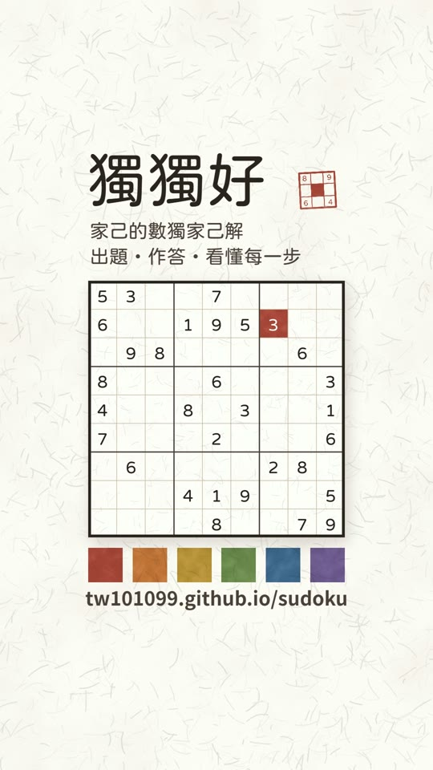

# 獨獨好

**家己的數獨家己解**　出題・作答・看懂每一步

👉 **https://tw101099.github.io/sudoku/**

點上圖看 28 秒介紹影片。

## 怎麼用

1. 選難度，按「出一題」。
2. 記下四位數的題號（例如 `2330`），抄到紙上或直接列印，慢慢寫。
3. 寫完回來，在首頁輸入同一組題號，就能對答案。

也可以直接在螢幕上寫。填錯標示、提示、自動筆記預設都是關的，想要再到設定打開。

## 看懂關鍵一步

看答案之後，可以一步一步看這題最關鍵的那一步。說明直接畫在盤面上：框起來的是正在看的地方，
打叉的是不能放的格子，一步一步帶到為什麼只能填這個數字。

## 六個難度

| 難度 | 需要的方法 |
|---|---|
| 入門 | 只要看「這格只剩一個數字」「這個數字只剩一格」，提示比較多 |
| 簡單 | 同上，提示比較少 |
| 中等 | 加上區塊排除、數對 |
| 困難 | 加上數組、X-Wing、XY-Wing 等 |
| 專家 | 加上推理鏈 |
| 極限 | 要先假設、往下推到矛盾，才知道某個數字不行 |

每一級各 999 題。題號第一個數字是難度，後三碼是第幾題，所以同一個題號永遠是同一題。

## 給長輩也好用

- 字級跟著手機、平板的系統設定走，字放到最大也不跑版。
- 只有首頁和題目兩個畫面，不會在頁面之間迷路。
- iPad 直放、橫放都能用。

## 隱私

不用註冊、不用登入，沒有廣告，也不追蹤。寫到一半的進度和做過的題目只存在你自己的裝置上。
沒有連續天數、徽章或每日限制，想寫就寫。

## 加到主畫面

- iPhone／iPad（Safari）：按「分享」→「加入主畫面」。
- Android（Chrome）：選單 →「安裝應用程式」或「加到主畫面」。

加到主畫面之後，沒有網路也能出題、寫題、對答案。

## 授權

MIT License，見 [LICENSE](LICENSE)。
